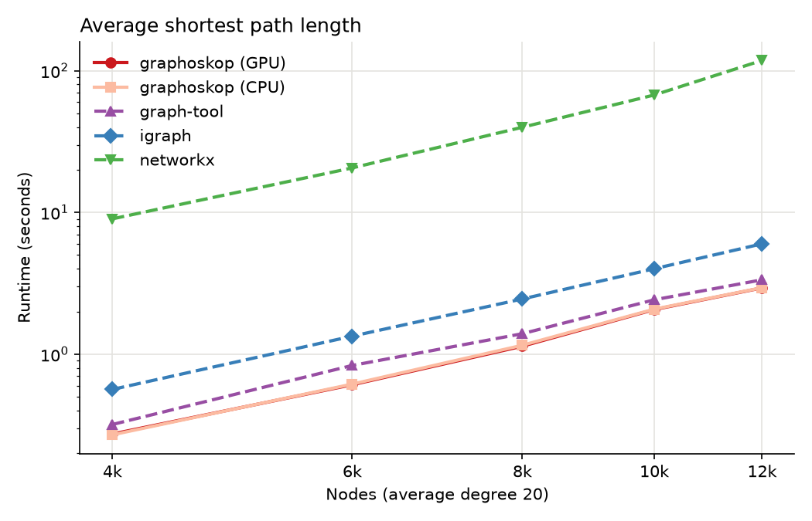
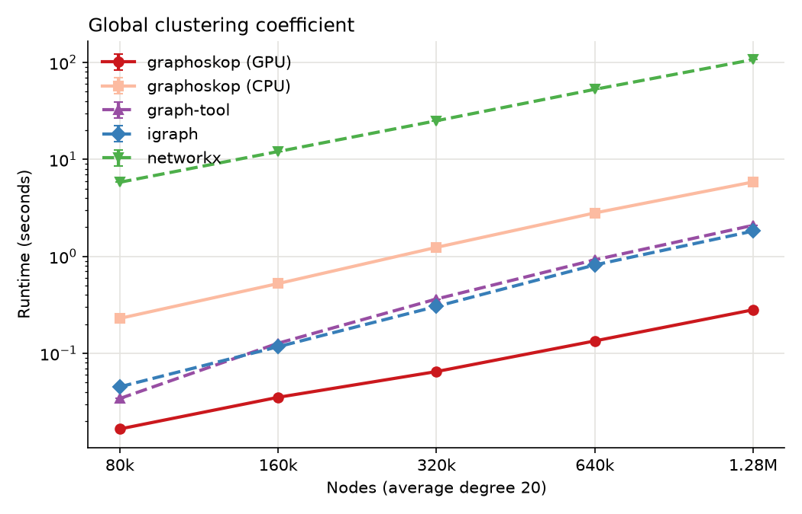
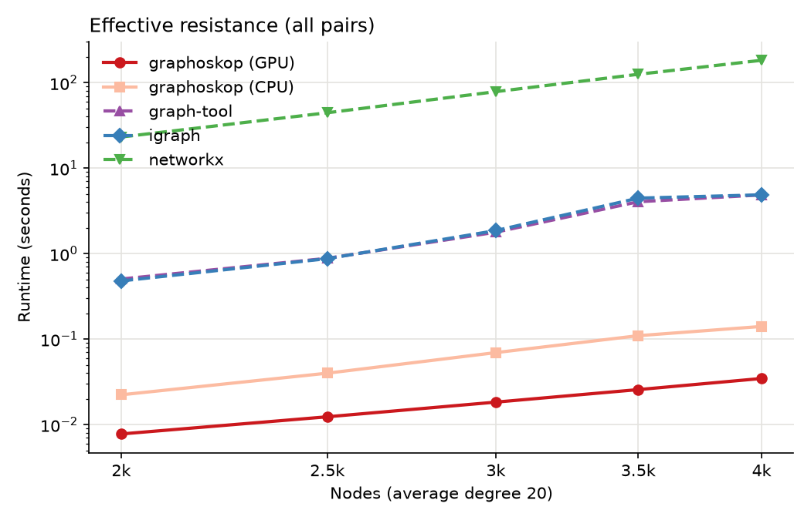
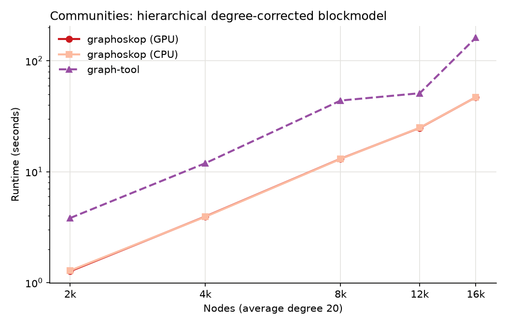

# Graphoskop

## Why Graphoskop

Graphoskop is a Python library for network analysis built around three ideas.

**Node attributes are first-class citizens.** Real networks come with information about their
nodes: ages, opinions, cities, categories. In Graphoskop, numeric and qualitative node attributes
are loaded together with the edges and stay attached to the nodes through every operation, so
that they can be analyzed with the network rather than next to it: how similar connected nodes
are, how a variable spreads or varies over the network, how communities relate to attributes.

**GPUs are native.** Graphoskop stores networks as PyTorch and PyTorch Geometric tensors, so the
same code runs on a CPU or on a GPU just by choosing the device when loading a network. Laplacian
operations, random walks, centralities and network generators are written to run on the device.

**It is a pedagogical companion to the textbook.** Graphoskop follows
[The Atlas for the Aspiring Network Scientist](https://www.networkatlas.eu/): its functions use
the concepts and the vocabulary of the book, so that students can try out what they read.

## Installation

Graphoskop requires Python 3.9 or later. Install it with pip:

    pip install graphoskop

This also installs its dependencies:

* [Numba](https://numba.pydata.org/)
* [NumPy](https://numpy.org/)
* [pandas](https://pandas.pydata.org/)
* [SciPy](https://scipy.org/)
* [PyTorch](https://pytorch.org/)
* [PyTorch Geometric](https://pytorch-geometric.readthedocs.io/)

To use a GPU, install the build of PyTorch matching your hardware first, following the
instructions on the [PyTorch website](https://pytorch.org/get-started/locally/).

## Usage

A network is loaded from an edge list and, optionally, a table of node attributes, as files or as
pandas DataFrames. For example, with a tab-separated edge list `edges.tsv`:

    source   target
    alice    carol
    carol    eve
    eve      alice
    bob      dave
    carol    bob

and a tab-separated node table `nodes.tsv`:

    node     age   city
    alice    34    Rome
    bob      29    Oslo
    carol    41    Rome
    dave     35    Oslo
    eve      52    Rome

one can check whether people tend to be connected to people of the same city:

    import graphoskop as gsk

    net = gsk.load_network("edges.tsv", "nodes.tsv")    # add device = "cuda" to work on a GPU
    gsk.assortativity(net, "city")                      # 0.52: same-city links are more common than by chance

Everything else, from centralities and communities to node attribute analysis and network
generators, is described in the documentation:
[graphoskop.readthedocs.io](https://graphoskop.readthedocs.io/en/latest/).

## Performance

The plots below compare the runtime of Graphoskop, on a CPU and on a GPU, with
[NetworkX](https://networkx.org/), [python-igraph](https://python.igraph.org/) and
[graph-tool](https://graph-tool.skewed.de/). Networks are LFR benchmark graphs
(`gsk.lfr_benchmark_graph`, average degree 20, largest degree 50, mixing parameter 0.3), of five
sizes up to the size where NetworkX takes about five minutes; every library works on the same
largest connected component, and only the computation is timed. Graphoskop's points are the
median of three runs; the other libraries, whose runtimes are long and steady, run once. Each
library runs with its default
settings: Graphoskop's shortest paths and graph-tool use all CPU cores, NetworkX and igraph use
one. Shortest paths run on the CPU whatever the device (see the documentation of shortest
paths), so the two Graphoskop lines of the first plot differ only by the transfer of the results.

igraph and graph-tool have no function for effective resistances: their lines take the Laplacian
from the library and finish with NumPy, as NetworkX does internally (pseudoinverse of the dense
Laplacian, in double precision). Graphoskop works in the precision of the network, single by
default.

Community discovery with the hierarchical degree-corrected stochastic blockmodel (the nested
blockmodel of Peixoto, `gsk.block_model_communities` with its default model) is compared only
with graph-tool (`minimize_nested_blockmodel_dl`), since NetworkX and igraph have no stochastic
blockmodels; here the largest network is the one where the slower library takes about a minute.
Both minimize the description length with their default settings: the fits are heuristic, so the
communities found, and their description lengths (saved with the runtimes), can differ.
Graphoskop's kernels are compiled on first use, and the timed runs are those after compilation.
The fit runs on the CPU whatever the device, so the two Graphoskop lines differ only by the
transfer of the edges.

The scripts that produce these plots are in the `benchmarks` folder of the repository: each test
runs on its own, e.g. `python benchmarks/global_clustering.py`, and writes its table of runtimes
and its plot.
